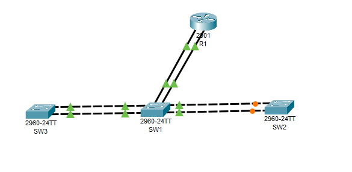
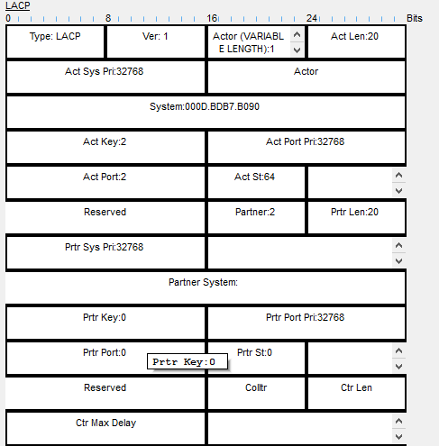

# Отчет по лабораторной работе №5

**Тема:** LAG / EtherChannel

**Выполнил:** Лобанцов А. О. и Канайкин А. А., гр. 409 

## Топология



## Ответы на вопросы

1. Часть интерфейсов между коммутаторами находится в заблокированном состоянии (оранжевый индикатор — Blocking/Discarding) из-за работы протокола **STP (Spanning Tree Protocol)**. Поскольку коммутаторы соединены параллельными линиями связи, в сети образовались физические петли коммутации (L2-петли), и STP автоматически блокирует избыточные пути для предотвращения широковещательного шторма и дублирования кадров. Интерфейсы маршрутизатора R1 по умолчанию административно выключены (`administratively down`), поэтому порты на линиях связи с R1 неактивны (красный индикатор).

2. Вывод диагностических команд на коммутаторе SW1 после настройки статического LAG:
```
SW1#show etherchannel summary
Flags:  D - down        P - in port-channel
        I - stand-alone s - suspended
        H - Hot-standby (LACP only)
        R - Layer3      S - Layer2
        U - in use      f - failed to allocate aggregator
        u - unsuitable for bundling
        w - waiting to be aggregated
        d - default port


Number of channel-groups in use: 1
Number of aggregators:           1

Group  Port-channel  Protocol    Ports
------+-------------+-----------+----------------------------------------------

1      Po1(SD)           -      Gig0/1(D) Gig0/2(D) 
SW1#show etherchannel port-channel
                Channel-group listing:
                ----------------------

Group: 1
----------
                Port-channels in the group:
                ---------------------------

Port-channel: Po1
------------

Age of the Port-channel   = 00d:00h:02m:09s
Logical slot/port   = 2/1       Number of ports = 0
GC                  = 0x00000000      HotStandBy port = null
Port state          = Port-channel 
Protocol            =   PAGP
Port Security       = Disabled

SW1#show interfaces Po1
Port-channel1 is down, line protocol is down (disabled)
  Hardware is EtherChannel, address is 000d.bd21.9834 (bia 000d.bd21.9834)
  MTU 1500 bytes, BW 2100000 Kbit, DLY 1000 usec,
     reliability 255/255, txload 1/255, rxload 1/255
  Encapsulation ARPA, loopback not set
  Keepalive set (10 sec)
  Half-duplex, 2100Mb/s
  input flow-control is off, output flow-control is off
  Members in this channel: 
  ARP type: ARPA, ARP Timeout 04:00:00
  Last input 00:00:08, output 00:00:05, output hang never
  Last clearing of "show interface" counters never
  Input queue: 0/75/0/0 (size/max/drops/flushes); Total output drops: 0
  Queueing strategy: fifo
  Output queue :0/40 (size/max)
  5 minute input rate 0 bits/sec, 0 packets/sec
  5 minute output rate 0 bits/sec, 0 packets/sec
     956 packets input, 193351 bytes, 0 no buffer
     Received 956 broadcasts, 0 runts, 0 giants, 0 throttles
     0 input errors, 0 CRC, 0 frame, 0 overrun, 0 ignored, 0 abort
     0 watchdog, 0 multicast, 0 pause input
     0 input packets with dribble condition detected
     2357 packets output, 263570 bytes, 0 underruns
     0 output errors, 0 collisions, 10 interface resets
     0 babbles, 0 late collision, 0 deferred
     0 lost carrier, 0 no carrier
     0 output buffer failures, 0 output buffers swapped out
```
Агрегированный канал `Po1` находится в состоянии **`SD`** (Switched, Down), а дочерние физические интерфейсы `Gi0/1` и `Gi0/2` — в состоянии **`D`** (Down). Канал **не готов** передавать трафик, так как интерфейсы на ответной стороне (маршрутизаторе R1) ещё не настроены и административно выключены.  
Использование статического режима (`mode on`) без протоколов согласования (LACP/PAgP) может вызвать проблемы, если ответная сторона настроена некорректно или не объединена в LAG: коммутатор принудительно считает порты единым каналом без проверки совместимости параметров, что может привести к потере пакетов или образованию L2-петли.

3. Вывод диагностических команд на коммутаторе SW1 после настройки LACP:
```
SW1#show etherchannel summary
Flags:  D - down        P - in port-channel
        I - stand-alone s - suspended
        H - Hot-standby (LACP only)
        R - Layer3      S - Layer2
        U - in use      f - failed to allocate aggregator
        u - unsuitable for bundling
        w - waiting to be aggregated
        d - default port


Number of channel-groups in use: 2
Number of aggregators:           2

Group  Port-channel  Protocol    Ports
------+-------------+-----------+----------------------------------------------

1      Po1(SU)           -      Gig0/1(P) Gig0/2(P) 
2      Po2(SD)           LACP   Fa0/1(I) Fa0/2(I) 
SW1#show etherchannel port-channel
                Channel-group listing:
                ----------------------

Group: 1
----------
                Port-channels in the group:
                ---------------------------

Port-channel: Po1
------------

Age of the Port-channel   = 00d:00h:17m:00s
Logical slot/port   = 2/1       Number of ports = 2
GC                  = 0x00000000      HotStandBy port = null
Port state          = Port-channel 
Protocol            =   PAGP
Port Security       = Disabled

Ports in the Port-channel:

Index   Load   Port     EC state        No of bits
------+------+------+------------------+-----------
  0     00     Gig0/1   On                 0
  0     00     Gig0/2   On                 0
Time since last port bundled:    00d:00h:08m:33s    Gig0/2
Group: 2
----------
                Port-channels in the group:
                ---------------------------

Port-channel: Po2    (Primary Aggregator)
------------

Age of the Port-channel   = 00d:00h:00m:21s
Logical slot/port   = 2/2       Number of ports = 0
GC                  = 0x00000000      HotStandBy port = null
Port state          = Port-channel 
Protocol            =   LACP
Port Security       = Disabled

SW1#show interfaces Po2
Port-channel2 is down, line protocol is down (disabled)
  Hardware is EtherChannel, address is 0002.173c.8a50 (bia 0002.173c.8a50)
  MTU 1500 bytes, BW 300000 Kbit, DLY 1000 usec,
     reliability 255/255, txload 1/255, rxload 1/255
  Encapsulation ARPA, loopback not set
  Keepalive set (10 sec)
  Half-duplex, 300Mb/s
  input flow-control is off, output flow-control is off
  Members in this channel: Fa0/1 ,Fa0/2 ,
  ARP type: ARPA, ARP Timeout 04:00:00
  Last input 00:00:08, output 00:00:05, output hang never
  Last clearing of "show interface" counters never
  Input queue: 0/75/0/0 (size/max/drops/flushes); Total output drops: 0
  Queueing strategy: fifo
  Output queue :0/40 (size/max)
  5 minute input rate 0 bits/sec, 0 packets/sec
  5 minute output rate 0 bits/sec, 0 packets/sec
     956 packets input, 193351 bytes, 0 no buffer
     Received 956 broadcasts, 0 runts, 0 giants, 0 throttles
     0 input errors, 0 CRC, 0 frame, 0 overrun, 0 ignored, 0 abort
     0 watchdog, 0 multicast, 0 pause input
     0 input packets with dribble condition detected
     2357 packets output, 263570 bytes, 0 underruns
     0 output errors, 0 collisions, 10 interface resets
     0 babbles, 0 late collision, 0 deferred
     0 lost carrier, 0 no carrier
     0 output buffer failures, 0 output buffers swapped out
```
Агрегированный канал `Po2` находится в состоянии **`SD`** (Switched, Down), а дочерние физические интерфейсы `Fa0/1` и `Fa0/2` — в состоянии **`I`** (Stand-alone / Independent) или **`D`** (Down). Канал **не готов** передавать трафик, так как на соседнем коммутаторе SW2 ещё не настроен LACP и согласование не завершено.

4. Содержимое сообщения LACPDU, отправленного коммутатором SW1 (синим/зелёным выделена информация о собственной системе — **Actor**, красным — о партнёре — **Partner**):
  
Информация о партнёре (**Partner**) заполнена нулями, так как на соседнем коммутаторе SW2 протокол LACP ещё не активирован. Коммутатор SW1 инициирует обмен и отправляет первый пакет LACPDU, ещё не получив ответных кадров от соседа, поэтому не располагает данными о его System ID, ключе и состоянии портов.

5. Разные номера LAG (`2` на SW1 и `1` на SW2) **не помешают** успешному согласованию агрегированного канала. Номер `channel-group` (и соответствующего интерфейса `Port-channel`) имеет исключительно локальное значение внутри конкретного устройства и не передаётся соседу. Протокол LACP идентифицирует участников и формирует канал по их **System ID** (приоритет системы + MAC-адрес) и операционному ключу (Operational Key).

Вывод команды проверки на коммутаторе SW2:
```
%LINK-5-CHANGED: Interface FastEthernet0/1, changed state to administratively down

%LINEPROTO-5-UPDOWN: Line protocol on Interface FastEthernet0/1, changed state to down

%LINK-5-CHANGED: Interface FastEthernet0/2, changed state to administratively down

%LINEPROTO-5-UPDOWN: Line protocol on Interface FastEthernet0/2, changed state to down

Creating a port-channel interface Port-channel 1

%LINK-5-CHANGED: Interface FastEthernet0/1, changed state to up

%LINEPROTO-5-UPDOWN: Line protocol on Interface FastEthernet0/1, changed state to up

%LINK-5-CHANGED: Interface FastEthernet0/2, changed state to up

%LINEPROTO-5-UPDOWN: Line protocol on Interface FastEthernet0/2, changed state to up

%SYS-5-CONFIG_I: Configured from console by console

%LINK-5-CHANGED: Interface Port-channel1, changed state to up

%LINEPROTO-5-UPDOWN: Line protocol on Interface Port-channel1, changed state to up

SW2#show etherchannel port-channel
                Channel-group listing:
                ----------------------

Group: 1
----------
                Port-channels in the group:
                ---------------------------

Port-channel: Po1    (Primary Aggregator)
------------

Age of the Port-channel   = 00d:00h:00m:12s
Logical slot/port   = 2/1       Number of ports = 2
GC                  = 0x00000000      HotStandBy port = null
Port state          = Port-channel 
Protocol            =   LACP
Port Security       = Disabled

Ports in the Port-channel:

Index   Load   Port     EC state        No of bits
------+------+------+------------------+-----------
  0     00     Fa0/1    Passive            0
  0     00     Fa0/2    Passive            0
Time since last port bundled:    00d:00h:00m:12s    Fa0/2>
```

6. Вывод диагностических команд на коммутаторе SW1 после настройки PAgP:
```
SW1#show etherchannel summary
Flags:  D - down        P - in port-channel
        I - stand-alone s - suspended
        H - Hot-standby (LACP only)
        R - Layer3      S - Layer2
        U - in use      f - failed to allocate aggregator
        u - unsuitable for bundling
        w - waiting to be aggregated
        d - default port


Number of channel-groups in use: 3
Number of aggregators:           3

Group  Port-channel  Protocol    Ports
------+-------------+-----------+----------------------------------------------

1      Po1(SU)           -      Gig0/1(P) Gig0/2(P) 
2      Po2(SU)           LACP   Fa0/1(P) Fa0/2(P) 
3      Po3(SU)           PAgP   Fa0/3(P) Fa0/4(P) 
SW1#show etherchannel port-channel
                Channel-group listing:
                ----------------------

Group: 1
----------
                Port-channels in the group:
                ---------------------------

Port-channel: Po1
------------

Age of the Port-channel   = 00d:00h:22m:40s
Logical slot/port   = 2/1       Number of ports = 2
GC                  = 0x00000000      HotStandBy port = null
Port state          = Port-channel 
Protocol            =   PAGP
Port Security       = Disabled

Ports in the Port-channel:

Index   Load   Port     EC state        No of bits
------+------+------+------------------+-----------
  0     00     Gig0/1   On                 0
  0     00     Gig0/2   On                 0
Time since last port bundled:    00d:00h:14m:13s    Gig0/2
Group: 2
----------
                Port-channels in the group:
                ---------------------------

Port-channel: Po2    (Primary Aggregator)
------------

Age of the Port-channel   = 00d:00h:06m:01s
Logical slot/port   = 2/2       Number of ports = 2
GC                  = 0x00000000      HotStandBy port = null
Port state          = Port-channel 
Protocol            =   LACP
Port Security       = Disabled

Ports in the Port-channel:

Index   Load   Port     EC state        No of bits
------+------+------+------------------+-----------
  0     00     Fa0/1    On                 0
  0     00     Fa0/2    On                 0
Time since last port bundled:    00d:00h:03m:23s    Fa0/2
Group: 3
----------
                Port-channels in the group:
                ---------------------------

Port-channel: Po3
------------

Age of the Port-channel   = 00d:00h:01m:19s
Logical slot/port   = 2/3       Number of ports = 2
GC                  = 0x00000000      HotStandBy port = null
Port state          = Port-channel 
Protocol            =   PAGP
Port Security       = Disabled

Ports in the Port-channel:

Index   Load   Port     EC state        No of bits
------+------+------+------------------+-----------
  0     00     Fa0/3    Desirable-Sl       0
  0     00     Fa0/4    Desirable-Sl       0
Time since last port bundled:    00d:00h:00m:26s    Fa0/4
```

7. Фрагмент текущей конфигурации коммутатора SW1 до настройки транкового режима на `Port-channel 2`:
```
SW1#show etherchannel summary
Flags:  D - down        P - in port-channel
        I - stand-alone s - suspended
        H - Hot-standby (LACP only)
        R - Layer3      S - Layer2
        U - in use      f - failed to allocate aggregator
        u - unsuitable for bundling
        w - waiting to be aggregated
        d - default port


Number of channel-groups in use: 3
Number of aggregators:           3

Group  Port-channel  Protocol    Ports
------+-------------+-----------+----------------------------------------------

1      Po1(SU)           -      Gig0/1(P) Gig0/2(P) 
2      Po2(SU)           LACP   Fa0/1(P) Fa0/2(P) 
3      Po3(SU)           PAgP   Fa0/3(P) Fa0/4(P) 
SW1#show etherchannel port-channel
                Channel-group listing:
                ----------------------

Group: 1
----------
                Port-channels in the group:
                ---------------------------

Port-channel: Po1
------------

Age of the Port-channel   = 00d:00h:22m:40s
Logical slot/port   = 2/1       Number of ports = 2
GC                  = 0x00000000      HotStandBy port = null
Port state          = Port-channel 
Protocol            =   PAGP
Port Security       = Disabled

Ports in the Port-channel:

Index   Load   Port     EC state        No of bits
------+------+------+------------------+-----------
  0     00     Gig0/1   On                 0
  0     00     Gig0/2   On                 0
Time since last port bundled:    00d:00h:14m:13s    Gig0/2
Group: 2
----------
                Port-channels in the group:
                ---------------------------

Port-channel: Po2    (Primary Aggregator)
------------

Age of the Port-channel   = 00d:00h:06m:01s
Logical slot/port   = 2/2       Number of ports = 2
GC                  = 0x00000000      HotStandBy port = null
Port state          = Port-channel 
Protocol            =   LACP
Port Security       = Disabled

Ports in the Port-channel:

Index   Load   Port     EC state        No of bits
------+------+------+------------------+-----------
  0     00     Fa0/1    On                 0
  0     00     Fa0/2    On                 0
Time since last port bundled:    00d:00h:03m:23s    Fa0/2
Group: 3
----------
                Port-channels in the group:
                ---------------------------

Port-channel: Po3
------------

Age of the Port-channel   = 00d:00h:01m:19s
Logical slot/port   = 2/3       Number of ports = 2
GC                  = 0x00000000      HotStandBy port = null
Port state          = Port-channel 
Protocol            =   PAGP
Port Security       = Disabled

Ports in the Port-channel:

Index   Load   Port     EC state        No of bits
------+------+------+------------------+-----------
  0     00     Fa0/3    Desirable-Sl       0
  0     00     Fa0/4    Desirable-Sl       0
Time since last port bundled:    00d:00h:00m:26s    Fa0/4
```

8. Фрагмент текущей конфигурации коммутатора SW1 после настройки транкового режима на `Port-channel 2`:
```
SW1#show running-config 
Building configuration...

Current configuration : 1539 bytes
!
version 15.0
no service timestamps log datetime msec
no service timestamps debug datetime msec
no service password-encryption
!
hostname SW1
!
!
!
no ip domain-lookup
!
!
!
spanning-tree mode pvst
spanning-tree extend system-id
!
interface Port-channel1
!
interface Port-channel2
 switchport mode trunk
 switchport nonegotiate
 spanning-tree portfast trunk
!
interface Port-channel3
!
interface FastEthernet0/1
 switchport mode trunk
 switchport nonegotiate
 channel-group 2 mode active
!
interface FastEthernet0/2
 switchport mode trunk
 switchport nonegotiate
 channel-group 2 mode active
!
interface FastEthernet0/3
 channel-group 3 mode desirable
!
interface FastEthernet0/4
 channel-group 3 mode desirable
!
interface FastEthernet0/5
!
interface FastEthernet0/6
!
interface FastEthernet0/7
!
interface FastEthernet0/8
!
interface FastEthernet0/9
!
interface FastEthernet0/10
!
interface FastEthernet0/11
!
interface FastEthernet0/12
!
interface FastEthernet0/13
!
interface FastEthernet0/14
!
interface FastEthernet0/15
!
interface FastEthernet0/16
!
interface FastEthernet0/17
!
interface FastEthernet0/18
!
interface FastEthernet0/19
!
interface FastEthernet0/20
!
interface FastEthernet0/21
!
interface FastEthernet0/22
!
interface FastEthernet0/23
!
interface FastEthernet0/24
!
interface GigabitEthernet0/1
 channel-group 1 mode on
!
interface GigabitEthernet0/2
 channel-group 1 mode on
!
interface Vlan1
 no ip address
 shutdown
!
!
!
!
line con 0
 logging synchronous
!
line vty 0 4
 login
line vty 5 15
 login
!
!
!
!
end
```
**Сравнение результатов:** Команды `switchport mode trunk` и `switchport nonegotiate`, применённые к логическому интерфейсу `Port-channel 2`, автоматически скопировались и применились ко всем входящим в него физическим портам (`FastEthernet0/1` и `FastEthernet0/2`). Команда `spanning-tree portfast trunk` осталась прописанной только на самом интерфейсе `Port-channel 2`, поскольку STP воспринимает агрегированный канал как единый логический порт.

9. На коммутаторе SW1 по умолчанию используется алгоритм балансировки по MAC-адресу источника — **`src-mac`**.  
Если большая часть трафика будет идти в направлении от маршрутизатора R1 ко многим получателям в сети, у всех кадров на выходе с R1 будет один и тот же MAC-адрес источника (MAC-адрес интерфейса маршрутизатора). В результате вычисление хеша будет давать одинаковый результат для всех потоков, и весь трафик пойдёт только по одному физическому линку, тогда как второй линк будет простаивать (проблема поляризации трафика).

10. Для решения проблемы выбран алгоритм **`src-dst-ip`** (балансировка на основе комбинации IP-адресов источника и назначения). В отличие от MAC-адресов, которые перезаписываются маршрутизатором R1, IP-адреса отправителей и получателей остаются неизменными и различаются для разных сессий и хостов, что позволяет равномерно распределять потоки по всем физическим линиям канала.

Проверка текущего алгоритма балансировки на коммутаторе SW1:
```
SW1#show etherchannel load-balance
EtherChannel Load-Balancing Operational State (src-dst-ip):
Non-IP: Source XOR Destination MAC address
  IPv4: Source XOR Destination IP address
  IPv6: Source XOR Destination IP address
```